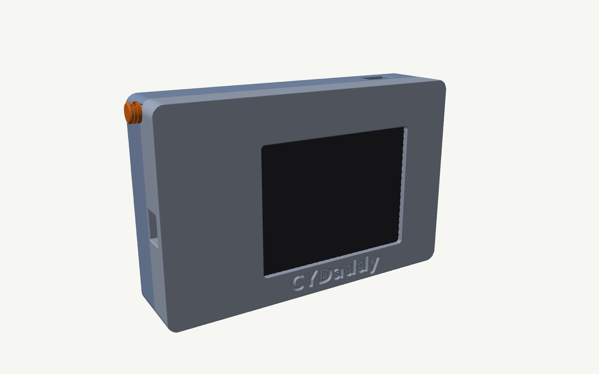
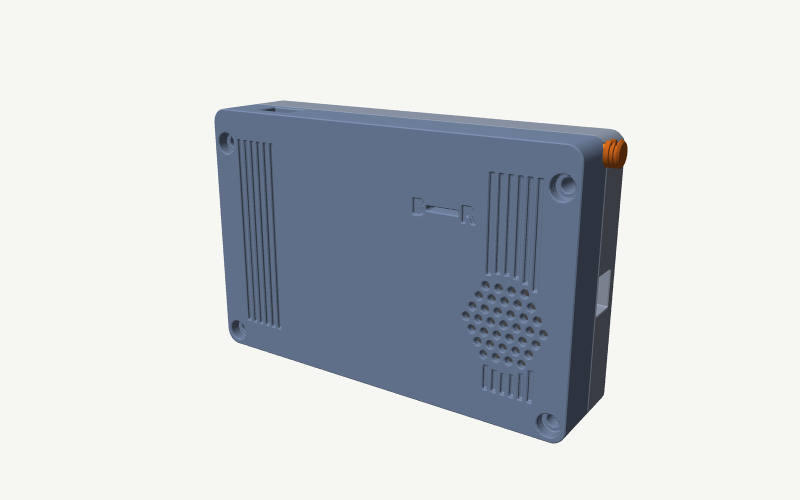
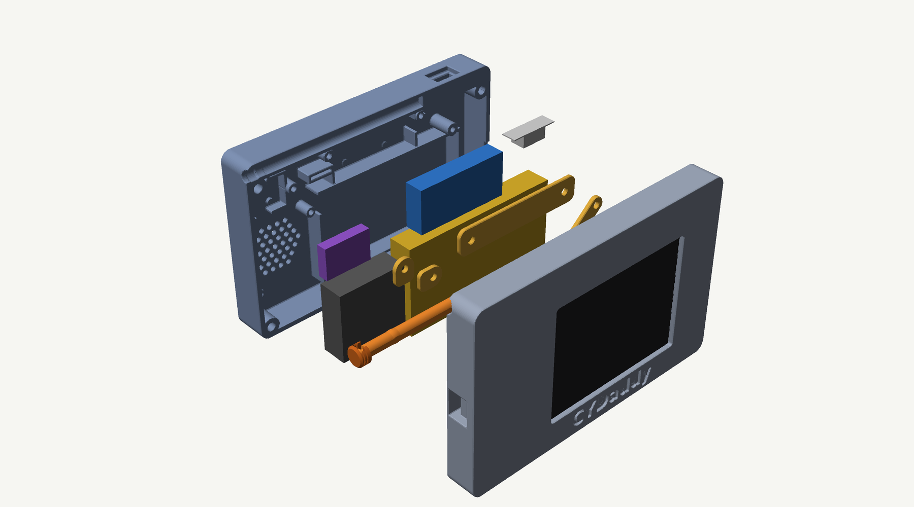

# CYDaddy Enclosure 7 Final

A 3D-printed handheld case for the **CYD (Cheap Yellow Display), board model ESP32-2432S028** with a LiPo battery, USB-C charging, a power switch, a speaker and a stylus. Built for the Scrappies pet game ([CodySDEV/skrappies](https://github.com/CodySDEV/skrappies)).

**Main board:** ESP32-2432S028 CYD, 2.8" 320x240 ILI9341, XPT2046 resistive touch, USB-C, PCB 85.9 x 50.2 mm. Case: 110.6 x 71.2 x 25.5 mm.

## Look at it in 3D

Open [`viewer/index.html`](viewer/index.html) through a web server (GitHub Pages works: Settings, Pages, deploy from the main branch, then open `/viewer/`). Opening the file directly from disk will not load the models. Use the "Pull apart" slider to see every layer.

## Build guide

1. [Hardware specs and parts list](docs/01_hardware_specs.md) (CYD details first)
2. [Wiring guide](docs/02_wiring_guide.md) (**set the boost to 5.0 V first**)
3. [Printing](docs/03_printing.md)
4. [Assembly](docs/04_assembly.md)
5. [Firmware](docs/05_firmware.md)
6. [Troubleshooting](docs/06_troubleshooting.md)
7. [Changelog](docs/07_changelog.md)

## Folders

| Folder | What is in it |
|---|---|
| `stl/` | Print-ready STL files (already oriented) and `PRINT_SETTINGS_7_FINAL.txt` |
| `images/` | Renders and dimensioned drawings |
| `schematics/` | Wiring diagrams (PNG and SVG), boost setup, connector pinouts |
| `viewer/` | In-browser 3D pull-apart viewer |
| `firmware/` | CYD hardware test sketch |
| `source/` | Python generator for the case and the render scripts |

## Known status

Print-verified: front shell, back shell (speaker, switch), straps. Not yet test-fitted: the reinforced charger tab and the three thicker stylus bodies.

## Regenerate the models

`source/scripts/make_case.py` builds the STL files. Needs Python with numpy, scipy, scikit-image, matplotlib and pillow. Paths inside the scripts point at the author's workspace; edit them first.
