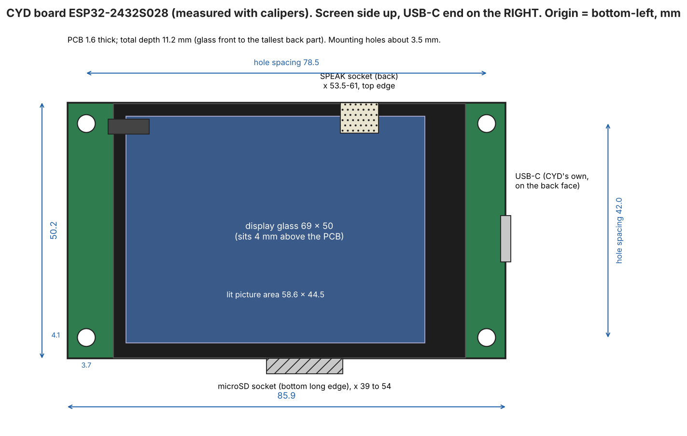

# 01 - Hardware specs and parts list

Everything in this build is measured, not guessed. Sizes marked "listed" come from the seller's page and were not verified with calipers. Everything else was measured with a digital caliper (a cheap carbon-fibre one that reads 0.05 to 0.15 mm low; the numbers below are the readings, and the printed parts were then fit-tested).

All lengths are in millimetres.

## 1. The brain: the CYD (Cheap Yellow Display)

| Item | Detail |
|---|---|
| Common name | **CYD, "Cheap Yellow Display"** |
| Board model | **ESP32-2432S028** (sometimes sold as "ESP32-2432S028R") |
| Quantity | 1 per unit |
| Microcontroller | ESP32 (dual core, Wi-Fi + Bluetooth), 4 MB flash, about 520 KB RAM |
| Screen | 2.8 inch, 320 x 240, SPI, **ILI9341** driver (the library needs `invertDisplay(true)` or the colours look inverted) |
| Touch | Resistive, **XPT2046** controller on its own SPI bus |
| Storage | microSD socket (on the bottom long edge) |
| Extras on board | RGB LED, light sensor (LDR), speaker amplifier with a 2-pin JST 1.25 mm socket (`SPEAK`), BOOT and RESET buttons |
| USB | **USB-C** on the right end, mounted on the back face of the PCB. *(Some CYD revisions use micro-USB or have two ports. Check yours. If your board is different, the USB opening and the D1 tap in this build will not line up.)* |
| Not on the board | No battery connector or charger, no motion sensor. This build adds a battery, charger, 5 V boost converter, power switch and speaker. |

### CYD pin settings (confirmed on our boards with test sketches)

| Function | Pins |
|---|---|
| Display bus (HSPI) | DC 2, CS 15, SCK 14, MOSI 13, MISO 12, no reset pin |
| Display rotation | 1 (landscape, 320 x 240) |
| Backlight | GPIO 21, HIGH = on |
| Touch bus (VSPI) | CLK 25, MISO 39, MOSI 32, CS 33, IRQ 36 |
| Touch raw range (rough) | x 200 to 3700 maps to 0 to 319, y 240 to 3800 maps to 0 to 239 |
| RGB LED | red 4, green 16, blue 17 (LOW = on) |
| Speaker | GPIO 26 (DAC) through the on-board amplifier to the `SPEAK` socket |
| Battery meter input | GPIO 35 (pin on connector P3) |

### CYD measurements (caliper)

| Feature | Measurement |
|---|---|
| PCB | **85.9 x 50.2**, 1.6 thick |
| Total depth (front glass to tallest back part) | 11.2 |
| Mounting holes | about 3.5 across, centres 3.7 from each end and 4.1 from top and bottom, so **78.5 x 42.0** between centres |
| Display glass | 69 x 50, sits 4 above the PCB front, left edge 9 from the left end |
| Lit picture area | 58.6 x 44.5, from x 11.5 to 70.1 and y 3 to 47.5 |
| USB-C | on the right end, 18.9 to 28.0 up from the bottom edge (about 9.1 wide), 3.2 tall |
| microSD socket | bottom long edge, 39 to 54 from the left end (15 wide) |
| BOOT / RST buttons | on the back, centred 12 from the left end and 5.8 from the top edge, about 4.2 apart |
| SPEAK socket | on the back, x 53.5 to 61.0 (7.5 wide), top 6 mm of the board; plug goes in from the back |

The measurements were checked with a printed fit jig. All four screws dropped in freely and the slot sat exactly over the BOOT and RST buttons.

## 2. Full parts list (per unit)

| # | Part | Spec | Notes |
|---|---|---|---|
| 1 | CYD board | ESP32-2432S028, 2.8" | see above |
| 2 | LiPo battery | JLJLUP **LP103665**, 3.7 V, "3000 mAh" (listed), with protection board | Body **65 x 36 x 9.7**. Real capacity is probably lower than listed (a pouch this size usually holds 2000 to 2500 mAh). Cut off the JST plug, tin the wires. **The plug polarity is not standard: check with a meter before connecting.** Wires about 56 long. |
| 3 | Charger | **TP4056 USB-C charger with protection** (LXLBES; the HiLetgo 5-pack is the same kind) | **18 x 12.1 x 4**. Pads: IN+/IN-, B+/B-, OUT+/OUT-. 1 A default. Its own USB-C port is only for bench tests. |
| 4 | Boost converter | **MT3608**, blue board with a brass trim-pot | **37.3 x 17.3 x 7.3**. Plated through-holes at the corners. Set to 5.0 V first (see the wiring guide). |
| 5 | Slide switch | **SS12F15**, 5 mm handle (from the VEXUNGA SPDT assortment) | Metal bracket 19.6 long with two eye holes 14.6 apart (hole size about 2.5 to 2.8). Body 10.5 x 5.8, 5 mm above the bracket, handle 5 mm. Use the middle pin and one outer pin. Test under load. |
| 6 | Speaker | DWEII **27 x 27 x 10**, 8 ohm, 2 W, JST-PH 1.25 mm 2-pin plug | Two mounting ears on opposite corners: ear underside 6.3 above the sound face, ear 1.7 thick, hole about 3 wide, holes about 33.9 apart on the diagonal. Nothing below about 500 Hz (chiptune is fine, bass is not). |
| 7 | Resistors | 2 x **100 k**, 1/4 W | Our pair measured 99.6 k and 99.7 k. Battery meter divider. |
| 8 | Wire | 26 AWG silicone, tinned: red, black, blue, orange | One orange wire is **100 long** (D1 tap). |
| 9 | Heat-set inserts | **M3 x 5.7 long x 4.6 OD**, brass (Amazon B0BVMMBG2N) | 4 per case |
| 10 | Screws | see the table below | |
| 11 | Heat shrink, hot glue, flux, solder | 63/37 solder, no-clean RMA flux | Clean flux off before closing the case |
| 12 | Filament | PLA+ (we used Overture PLA Professional) | one spool is plenty (amount per case not weighed) |
| 13 | Glue | CA (super glue) for the stylus knob | |

**Not used any more (earlier plans):** USB-C breakout board, extra 1N5819 diode, cut USB cable. The CYD's own USB-C is the one outside port. Charging works through a single wire tapped from the CYD's diode **D1** (see the wiring guide).

### Screws

| Where | Screw | Qty | Into |
|---|---|---|---|
| CYD to the front shell | **M3 x 5** (an M3 x 6 is too long) | 4 | printed posts (self-tapping) |
| Closing the case, from the back | **M3 x 12 or M3 x 16**, hex socket | 4 | brass inserts in the front shell. We designed for M3 x 16 and used M3 x 12 if the 16 bottomed out. The back shell holes are 3.6 with 6 mm counterbores. |
| Battery strap | **M2.5 x 8** | 2 | printed posts (pilot 2.1) |
| Booster strap | **M2.5 x 8** | 2 | printed posts |
| Charger tabs | **M2.5 x 8** | 2 | printed posts |
| Speaker ears | **M2.5 x 6** | 2 | printed posts (pilot 2.1), 6.3 tall |
| Power switch ears | **M2 x 4** (not longer) | 2 | pilot holes 1.8 mm, 3.6 deep in the top wall |

The M3 screw assortment used was a 720-piece stainless hex-socket kit (M3 x 6 to 30). Standard M3 cap screws have a 5.5 head and a 2.5 hex key.

## 3. Tools

- 3D printer: we used a **FlashForge Adventurer 5M Pro** (new, first prints were the test blocks below). The biggest part is 110.6 x 71.2 mm, so you need a bed of at least about 120 x 90 mm.
- Soldering iron with adjustable temperature. We solder at about 650 F (700 F for big pads) with 63/37 solder.
- Heat-set insert tip for the iron (M3). We install at the lowest dial setting (200) slowly.
- Multimeter (continuity and DC volts), small bench supply is very helpful for setting the boost.
- Calipers, 3.5 mm drill bit or a spare screw (to clear stringing in screw holes).
- Small screwdrivers, hex keys (2.5 mm), wire strippers, flush cutters.

## 4. Fit tests worth printing first

These small tests (STL files in `source/test_prints/`) removed the guesswork. Results from our printer:

| Test | Result |
|---|---|
| Hole test 3.0 to 3.6 | 3.4 is a snug M3 fit, **3.5 drops through freely**. The model uses 3.6 so stringing cannot close it. |
| Insert test blocks (3.8 to 4.3) | All held. **4.3 mm pilot** looks best (least melted plastic around the top). |
| Fit jig | The plate matched the real CYD in every position (screws, BOOT/RST slot, SD, USB-C). |
| Stylus ring test | Bump bore radius 2.05 clicks in and pulls out. 1.95 is too tight to pull out. |

Next: [02 Wiring guide](02_wiring_guide.md)
