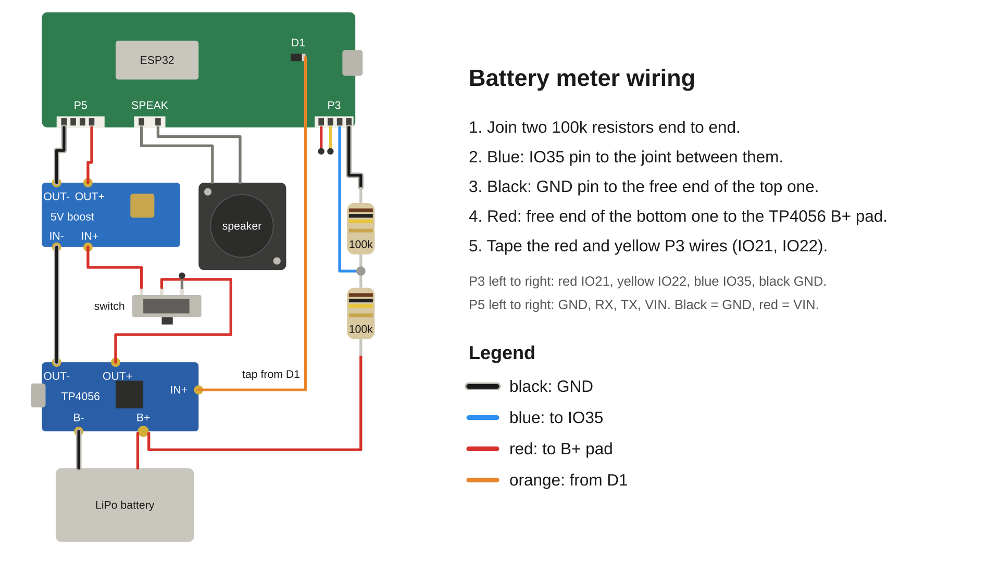
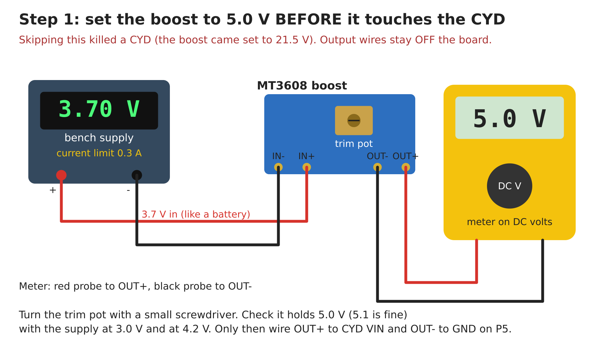
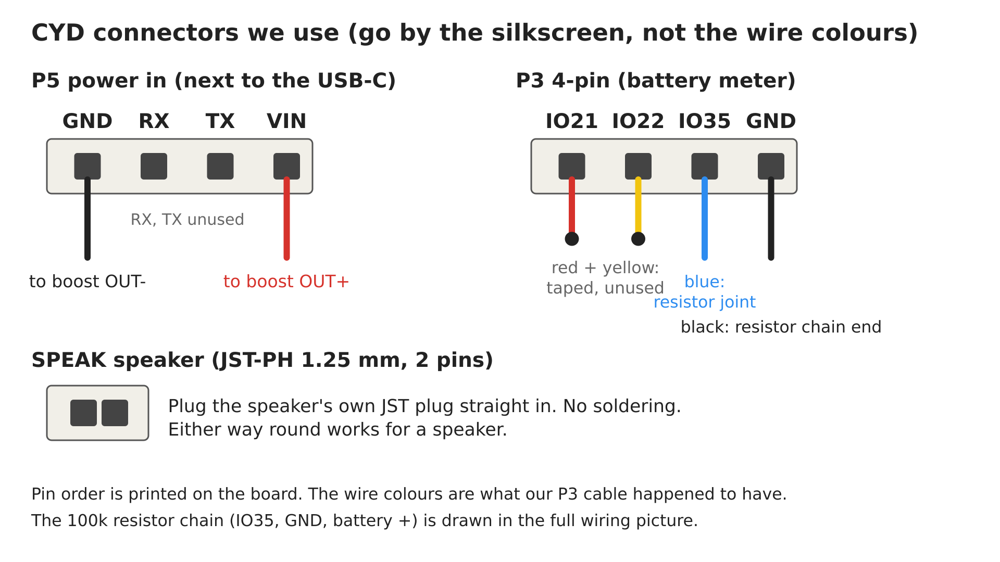

# 02 - Wiring guide

**Read this whole page before you touch a soldering iron.** One of our two builds died because step 1 below was skipped.

## The power idea in one paragraph

The CYD's **own USB-C port is the only port on the outside**. It charges and it flashes. A battery, a charger board, a slide switch and a 5 V boost converter sit inside. The boost converter feeds the CYD's `VIN` pin (connector P5). One thin wire from the CYD's USB-side diode **D1** goes to the charger's `IN+`, so plugging USB in charges the battery. D1 stops the battery's 5 V from flowing back out to the USB port.

```
battery  <->  TP4056 B+/B-
TP4056 OUT+  ->  slide switch (middle pin)  ->  boost IN+      (switch outer pin)
TP4056 OUT-  ->  boost IN-
boost OUT+   ->  CYD P5  VIN
boost OUT-   ->  CYD P5  GND
D1 (USB side) ->  100 mm orange wire  ->  TP4056 IN+
```

Grounds are already shared on the CYD (USB ground, the P5 ground and the battery minus all meet there), so the tap wire is the **only** extra wire for charging.

## The full wiring picture



(A portrait version for phones is `schematics/CYDaddy_full_wiring_portrait.png`. The SVG sources are next to them.)

Wire colours in the picture: black is ground, red is battery plus / power, blue goes to IO35, orange comes from D1. Your wire colours can be different. **Go by the labels printed on each board.**

## Step 1: set the boost converter to 5.0 V first (never skip this)



1. Do **not** connect the boost output to the CYD yet. Leave the output pads empty.
2. Feed `IN+` and `IN-` from a bench supply set to 3.7 V (like a battery), with the current limit at 0.3 A.
3. Put the meter on `OUT+` and `OUT-`, on DC volts.
4. Turn the brass trim-pot with a small screwdriver until the meter reads **5.0 V** (5.1 is fine).
5. Change the supply to 3.0 V and then to 4.2 V. The output must stay at about 5.0 V.
6. Re-measure with nothing connected right before you wire it to the CYD.

Why it matters: the boost came from the factory set to a much higher voltage. On our second unit nobody set it and the CYD saw **21.5 V** on VIN. The board died instantly (VIN to GND became a dead short, 0.1 ohm) and the pet game save on it was lost. A boost converter can only go **up** from its input, so 5.0 V works from the battery (3.0 to 4.2 V) but never set it lower than its input.

## Step 2: check each part before it goes in

| Part | Check |
|---|---|
| Battery | Meter on the cut wires: about 3.7 to 4.2 V. The plug polarity on these packs is **not** standard, so find which wire is plus. Cut the plug off one wire at a time, tape the cut ends. |
| TP4056 | On the bench with USB into its own port: LED red while charging, blue (or green) when full or with no battery. |
| Slide switch | Continuity from the middle pin to one outer pin in one position, open in the other. Test it under load later (it should stay cool). Our **first** switch was bad: the CYD cut out when the lever moved and took 5 s to start. A replacement fixed both. |
| Speaker | Plugs straight into `SPEAK`. No soldering. |
| Bare CYD | **P5 VIN to GND must NOT beep.** If it beeps, the board is already damaged. |

## Step 3: connectors on the CYD



- **P5** (next to the USB-C): left to right **GND, RX, TX, VIN**. Boost OUT- goes to GND, boost OUT+ goes to VIN. Nothing on RX and TX.
- **P3** (4-pin): left to right **IO21, IO22, IO35, GND**. Our cable's wires happened to be red, yellow, blue, black. We use **blue (IO35)** and **black (GND)**. The red and yellow stay unconnected and are taped.
- **SPEAK**: the speaker's JST plug.

The CYD's `P1` in some older notes is this same P5 connector.

## Step 4: the battery meter (two resistors)

The game shows a battery percentage. It reads the battery voltage on **IO35** through a voltage divider of two equal **100 k** resistors:

1. Solder the two resistors end to end (clip the leads short; resistors have no polarity). Check each with the meter: ours read 99.6 k and 99.7 k.
2. **Blue wire (IO35)** to the joint between them.
3. **Black wire (GND)** to the free end of one resistor.
4. A **red wire** from the free end of the other resistor to the **TP4056 B+ pad** (the same pad as the battery's red wire).
5. Tape the red and yellow wires of the P3 cable.

The firmware samples this 16 times, averages and doubles it, then uses a LiPo discharge curve for the percentage. Valid range 2.5 to 4.6 V.

**Known quirk:** while USB is charging, the battery voltage reads higher than its true resting level (we saw 71 percent jump to 92 while charging), so the percentage is not accurate until you unplug and wait a minute. The hardware has no way to tell the CYD that USB is plugged in without an extra wire, so the build leaves it as it is.

## Step 5: assembly order that worked (do one stage at a time and measure)

1. Bare new CYD: measure P5 VIN to GND (must not beep).
2. Power the CYD alone over USB and check the screen works.
3. Set the boost to 5.0 V (step 1). Solder the boost output to P5 **only now**. Keep iron time short on the P5 pins.
4. Add the rest of the chain: battery to the charger, charger OUT+ to the switch, switch to boost IN+, charger OUT- to boost IN-. Measure VIN to GND after each stage.
5. Solder the **orange tap wire (100 mm)** from the **USB side** end of D1 (the end nearest the USB-C) to the charger `IN+`. Check no short to GND.
6. Add the battery meter resistors last.
7. Plug USB in: the CYD runs and the charger LED goes red. Unplug USB with the switch on: it keeps running from the battery.

## Soldering notes

- 63/37 solder, liquid flux, iron at about 650 F (700 F for big pads). If you have a 390 to 840 F range, start in the middle.
- The boost has plated through-holes: put the wire through the hole and solder underneath.
- Clean flux off before closing the case (no-clean RMA flux is non-corrosive but sticky).
- Strain-relieve every wire. A loose bench connection once looked like a dead board.
- Resistance checks only mean something with everything **unpowered**.

## Behaviour of the finished power system

- The unit stays on while charging. With USB plugged in it runs from USB even if the switch is off, and the battery still charges. A true kill switch would need D1 removed (then the CYD could not run from USB alone). We chose not to.
- Backfeed test (USB unplugged, battery on): the USB side of D1 reads about 0.8 V on a meter with nothing loaded and 0 V with a 1 kohm load. That is leakage, not a problem.
- Bench-tested numbers: charging made the TP4056 LED red with the voltage rising past 4.07 V, the chip only warm. The CYD runs from the battery chain, and the boost stays at 5.0 V with the charger plugged in.
- Estimated draw about 0.1 to 0.17 A at 5 V (roughly 0.3 A from the cell). Measure your own with the meter in series.

Next: [03 Printing](03_printing.md)
