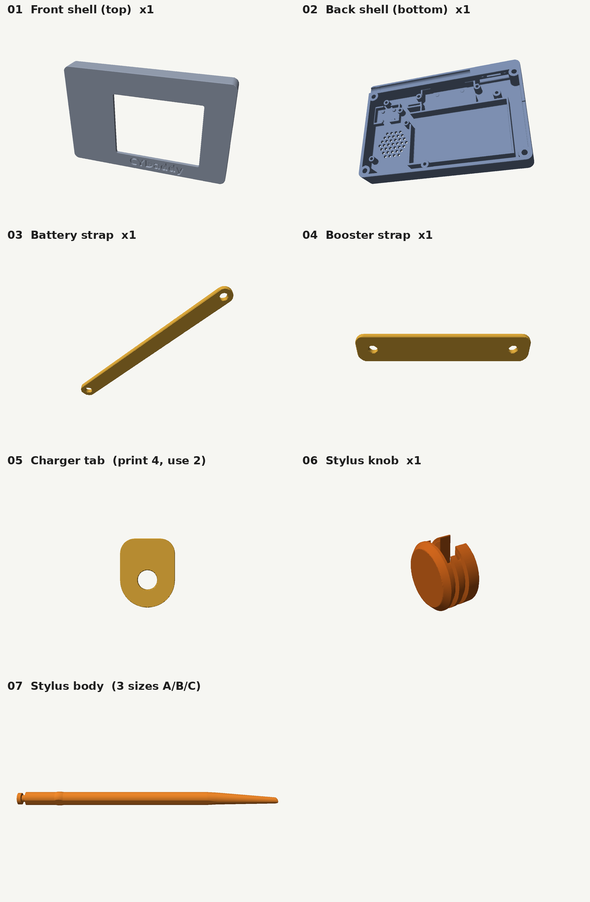
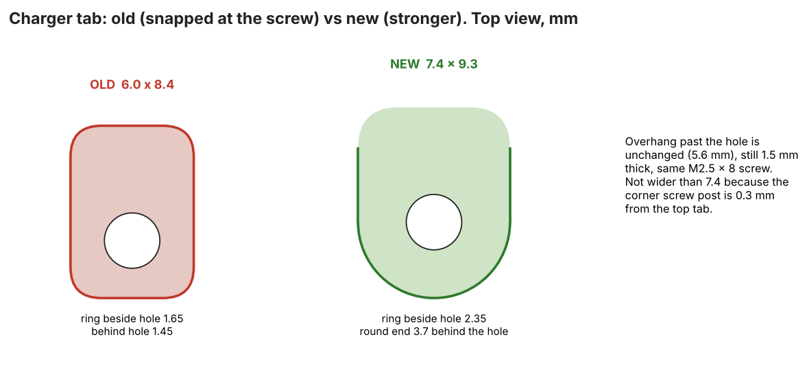

# 03 - Printing

All STL files are in the [`stl/`](../stl) folder, **already turned the right way to print**. Do not rotate anything. The full text version of these settings is `stl/PRINT_SETTINGS_7_FINAL.txt`.

## What to print

| File | Qty | What it is |
|---|---|---|
| `CYDaddy_7_01_front_shell_TOP.stl` | 1 | Front shell: screen window, CYD posts, 4 insert pockets, stylus tunnel, lanyard bar |
| `CYDaddy_7_02_back_shell_BOTTOM.stl` | 1 | Back shell (already flipped, flat back wall on the bed): battery pocket, speaker posts, switch mount, straps posts, grille, grooves |
| `CYDaddy_7_03_battery_strap.stl` | 1 | Diagonal strap that holds the battery |
| `CYDaddy_7_04_booster_strap.stl` | 1 | Strap that holds the MT3608 boost |
| `CYDaddy_7_05_charger_tabs_x4_REINFORCED.stl` | 1 plate | 4 tabs, use 2 (spares because tabs can still break) |
| `CYDaddy_7_06_stylus_knob.stl` | 1 | Round knob you pull on |
| `CYDaddy_7_07A/B/C_stylus_body_*.stl` | 1 | Stylus body, three thicknesses (see below) |

Plate 1 (case parts) and plate 2 (stylus) use different settings, below.

## Plate 1: case parts

| Setting | Value |
|---|---|
| Layer height | 0.16 (first layer 0.2) |
| Wall loops | 4; top and bottom layers 5 |
| Infill | 20 percent (tabs: 100 percent) |
| Outer wall speed | 40 mm/s |
| Seam | Back |
| Supports / brim | Off (a small brim, outer only 6 mm, helped a lifting corner on the fit jig) |
| Nozzle | 220 first layer, 215 after |
| Bed | textured PEI, 60 first layer, 55 after |
| Retraction | default (0.8 mm), wipe while retracting on |

Tips from our prints:

- **Dry the filament.** The first front shell strung badly all over. A dried or fresh spool fixes it.
- Clean the plate with isopropyl.
- Clear the four M3 holes in the back shell with a 3.5 mm drill or a spare screw. Any string closes a hole. (The model already makes them 3.6 mm.)
- Our printer is a FlashForge Adventurer 5M Pro, printed from Flash Studio. Filament was Overture PLA Professional as a custom profile. Any PLA+ at those temperatures should be fine.

## Plate 2: stylus

| Setting | Value |
|---|---|
| Layer height | 0.12 (first layer 0.2) |
| Wall loops | 4; top and bottom layers 5 |
| Infill | **100 percent** |
| Outer wall speed | 30 mm/s |
| Seam | Back |
| Supports / brim | Off |
| Nozzle | 220 first layer, 215 after |
| Bed | 60 first layer, 55 after, **glue stick** on the plate |

The stylus body lies flat. The knob stands up on the face that goes against the case.

### Which stylus body?

The first slim stylus (3.5 mm barrel) was too skinny to hold in the tunnel. We made three thicker ones, measured by how much bigger **around** the barrel is:

| File | Around the barrel | Barrel width |
|---|---|---|
| `07A` | +1.0 mm | 3.82 mm |
| `07B` | +1.2 mm | 3.88 mm |
| `07C` | +1.5 mm | 3.98 mm |

The case tunnel is 4.4 mm wide, so nothing wider than about 4.1 mm would go in. The click ridge is the same size on all three (a radius of 2.08 that clicks into the case bump), so the thicker the barrel, the smaller the ridge stands out. **Start with B**, and print the others only if it is too loose or too tight.

## After printing

1. **Heat-set inserts** into the four front shell corner posts. Pockets are 4.3 mm. Insert M3 x 5.7 x 4.6 brass inserts with the narrow end in. Iron on its lowest setting (200 on our LDK 60 W; the dial is probably not exact), slow, light pressure, stop just short of flush, then press flush and let cool. In our tests every pilot from 3.9 to 4.3 mm held; 4.3 looked cleanest.
2. **Stylus:** slide the flange at the end of the body into the side slot of the knob until the thin neck sits in the narrow slit. The lip inside the knob sits behind the flange, so pulling the knob pulls the stylus. Put a drop of CA glue in the slot.
3. Test: the stylus slides into the tunnel tip first until the knob touches the end wall, and the ridge **clicks** into the groove. It should pull back out with a firm tug.

## What was learned about each part

- **Speaker posts**: 33.9 mm apart on the diagonal (the first version at 33.4 was too tight; +0.5 mm is perfect).
- **Switch mount**: two 1.8 mm pilot holes for M2 x 4 screws, plus a finger notch around the nub so the 5 mm nub sticks out about 2.6 mm. Screws go in and hold. Perfect on the verified print.
- **Charger tabs**: the old 6.0 x 8.4 tab snapped at the screw. The new tab is 7.4 wide with a round end 3.7 behind the hole.

**Honest status:** the front shell, back shell (speaker and switch) and straps are print-verified. The reinforced tab and the three thicker stylus bodies were made last and had **not** been test-fitted when this guide was written. If you try them, please report what you find.

## Slicer warnings you may see

Slicers may report small overhangs around the switch pocket (the pocket roof, the notch ceiling and a thin lip above the notch). They bridge only a few millimetres and printed fine without supports.

Next: [04 Assembly](04_assembly.md)
