# 04 - Assembly, step by step

You need the printed parts ([03 Printing](03_printing.md)), the electronics from [01 Hardware](01_hardware_specs.md) and a boost converter that is already set to 5.0 V ([02 Wiring](02_wiring_guide.md), step 1).

Open the **[3D viewer](../viewer/index.html)** next to this page. Slide "Pull apart" to see every layer in the order you build it.

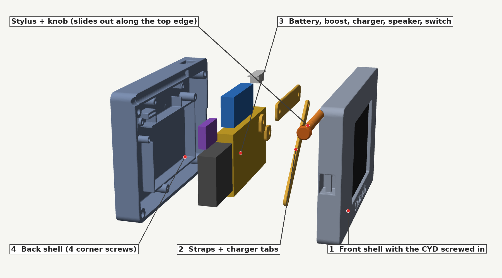

The layers, front to back:

1. **Front shell** with the CYD screwed in (and the stylus in the top edge)
2. **Straps and tabs**
3. **Electronics:** battery, boost, charger, speaker, switch
4. **Back shell**

## Step 1: test the CYD before anything else

Do this before you print or solder, so you know the board is good. See [05 Firmware](05_firmware.md) for the test sketch. If the screen shows colours correctly and touch moves a dot, you have the display and touch variant this build expects.

## Step 2: put the CYD in the front shell

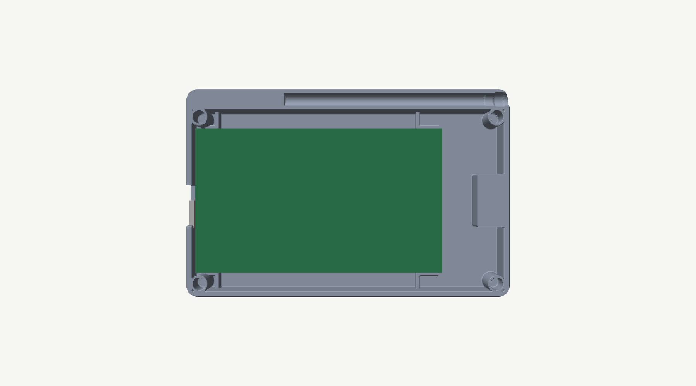

1. The front shell has four posts for the CYD and corner ribs that locate the glass. Lay the shell face down.
2. Set the CYD in, screen toward the window, **USB-C end toward the right when you look at the screen**.
3. Four **M3 x 5** screws through the corner holes into the posts. Do not use M3 x 6: it is too long. No washers.
4. Check: screen centred in the window, no light gap, USB-C lined up with the opening in the end wall.

The inside of the empty front shell, for reference:

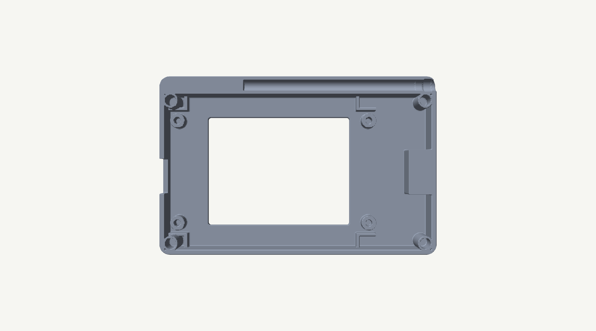

## Step 3: heat-set the inserts

If you have not done it yet: four M3 brass inserts into the four corner posts of the front shell (pockets 4.3 mm). Slow, low heat, flush. Wait until cool before you put a screw in.

## Step 4: wire the electronics outside the case

Follow [02 Wiring](02_wiring_guide.md). Solder the boost to P5 **only after** it reads 5.0 V on the bench. Do the battery chain, the orange 100 mm tap wire from D1 to the charger `IN+`, and the two resistors. Leave the wires a little long for now.

## Step 5: place the parts in the back shell

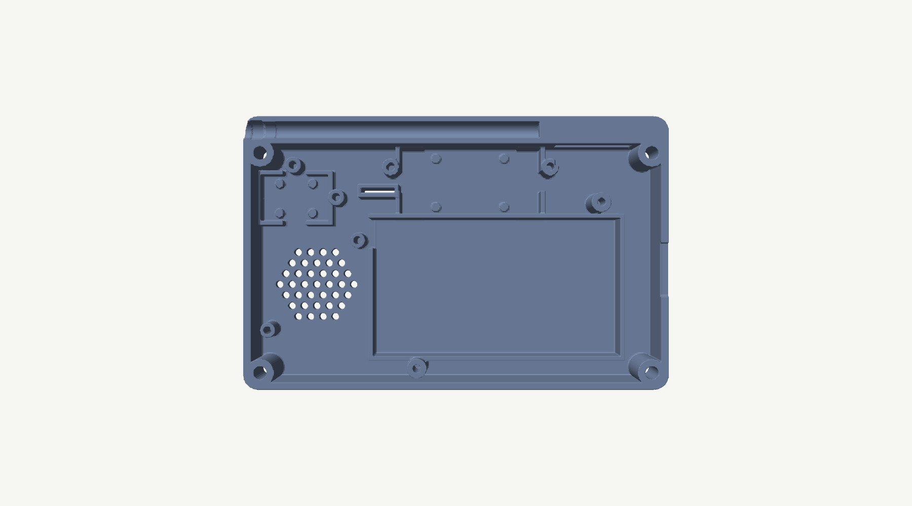
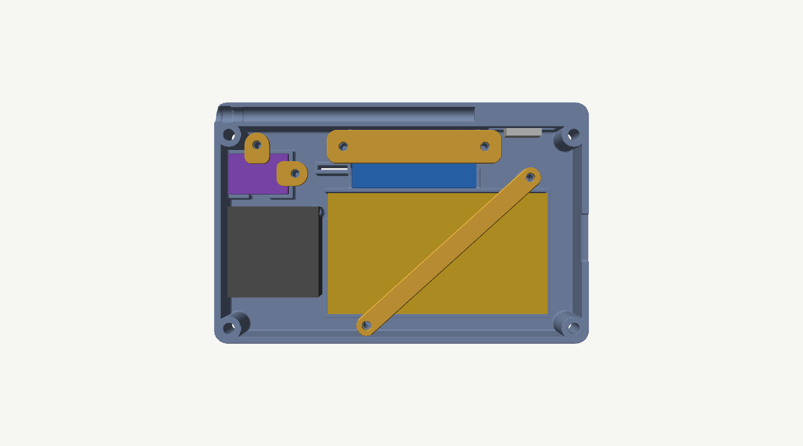

Orientation: look into the open back shell with the lanyard end on the **left** and the USB end on the **right**.

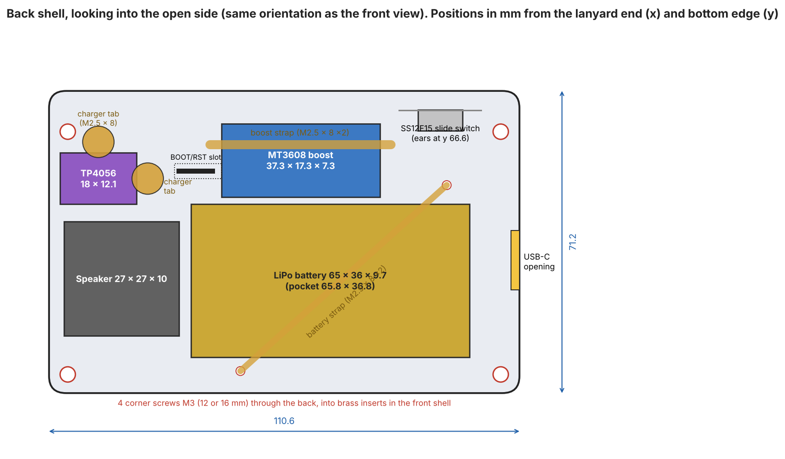

| Part | Where | How it is held |
|---|---|---|
| **Speaker** (27 x 27 x 10) | lower left, sound face against the back wall, over the round grille | two screws **M2.5 x 6** through the two ears into the two posts (opposite corners). The wire exits toward the bottom edge. |
| **Battery** (65 x 36) | right, in its framed pocket | **diagonal strap** with two **M2.5 x 8** screws |
| **MT3608 boost** (37 x 17) | top middle | **straight strap** with two **M2.5 x 8** screws |
| **TP4056 charger** (18 x 12) | top left | **two tabs** with **M2.5 x 8** screws, one on the top edge, one on the end opposite the USB-C end. The tabs only stop the board from coming out; don't overtighten them (the old ones snapped). |
| **Slide switch** SS12F15 | top edge, near the USB end | two **M2 x 4** screws through the ears into the wall (see below) |

Order that worked: speaker first (plug it into `SPEAK` last, when the case is almost closed), then battery and strap, then boost and strap, then charger and tabs, then the switch.

### The switch (the tricky one)

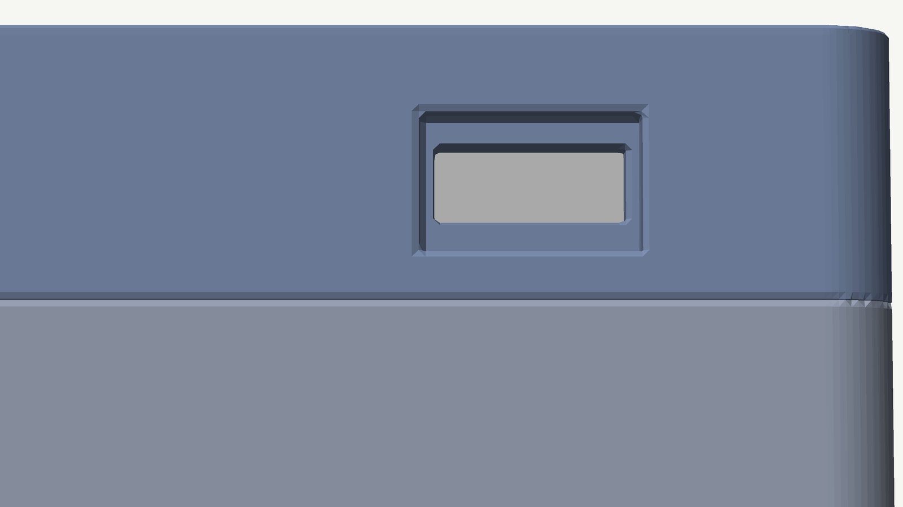

- The switch sits in a pocket under the top wall. Its metal ears press **up** against the ceiling of the pocket.
- Two M2 screws go up through the ear holes into two 1.8 mm pilot holes that go 3.6 mm into the wall. The wall above the pocket is only 4.4 mm, so the screw must be **M2 x 4**. A longer screw pokes through the outside.
- The 5 mm nub comes out through a slot. A finger notch lowers the wall around it, so the nub sticks out about 2.6 mm and is easy to push.
- Turn the screws gently. Printed plastic threads strip if you force them.

### Wiring into the pockets

- Keep the wires from the boost and charger on top of the parts so the straps do not pinch them.
- Use hot glue or heat shrink for strain relief, so no solder joint carries any pull.
- Plug the speaker's JST plug into the `SPEAK` socket on the CYD.
- The wire that goes from P3 to the resistor chain has to reach the charger's B+ pad, so route it before the straps go on.

## Step 6: close the case

1. Make sure no wire is pinched between the shells.
2. Set the back shell on the front shell: both shells meet at the split line, matching corners.
3. Four hex-head **M3 x 12** (or **x 16**) screws from the back, through the 3.6 mm holes in the corner posts, into the brass inserts. If a 16 mm screw bottoms out before the shells close, use the 12.
4. Tighten evenly in a cross pattern. Stop when the shells meet; do not crush.

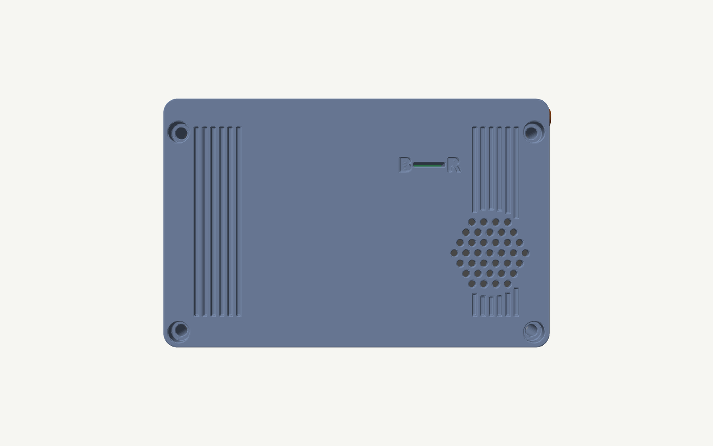

## Step 7: the stylus and knob (not final)

> None of the three stylus bodies fit in our test prints, so this step is on hold until the redesign. The case works fine without it.

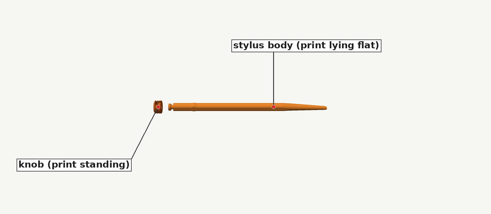

- Glue the knob to the stylus (slide the flange into the knob slot, a drop of CA glue).
- Slide the stylus into the tunnel along the top edge, **tip first**, from the lanyard end, until the knob touches the case. There is a **click** when the ridge seats in the groove.
- The tunnel is closed at the far end, so the tip cannot come out the other side.

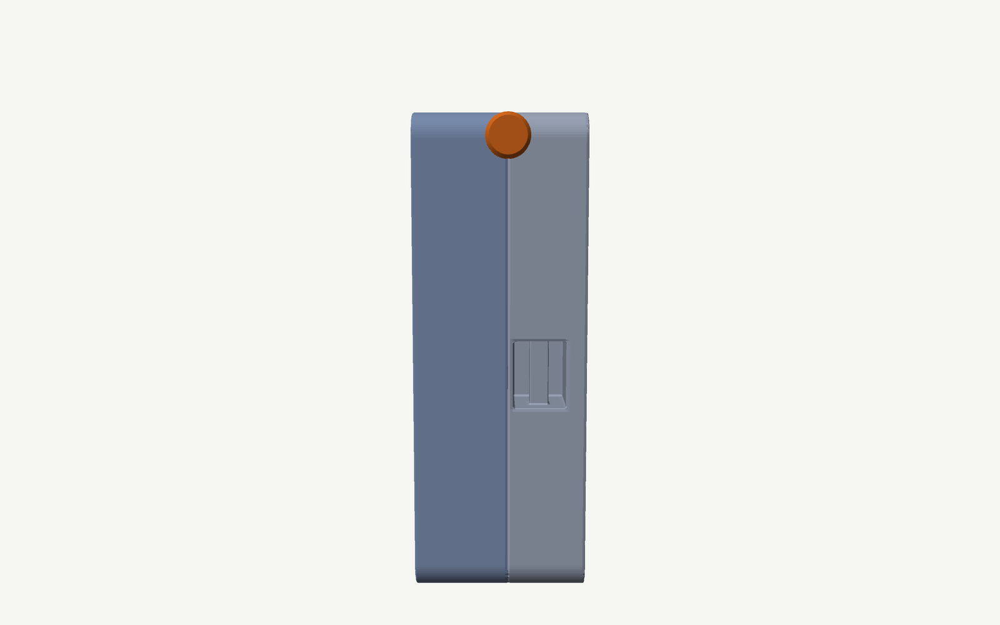

## Step 8: first power-up checklist

- [ ] Switch off, plug USB: the screen comes on, the charger LED is red (charging).
- [ ] Unplug USB, switch on: the screen runs from the battery.
- [ ] Switch off with USB unplugged: the CYD shuts off.
- [ ] The battery percentage looks sensible after unplugging USB for a minute.
- [ ] Tap the screen: touch works to the edges.
- [ ] Speaker plays a sound (once the game's sound effects are in your firmware).
- [ ] BOOT / RST buttons work with a pin through the slot on the back.
- [ ] Nothing gets hot: the charger chip should be warm at most.

## What you can reach from outside

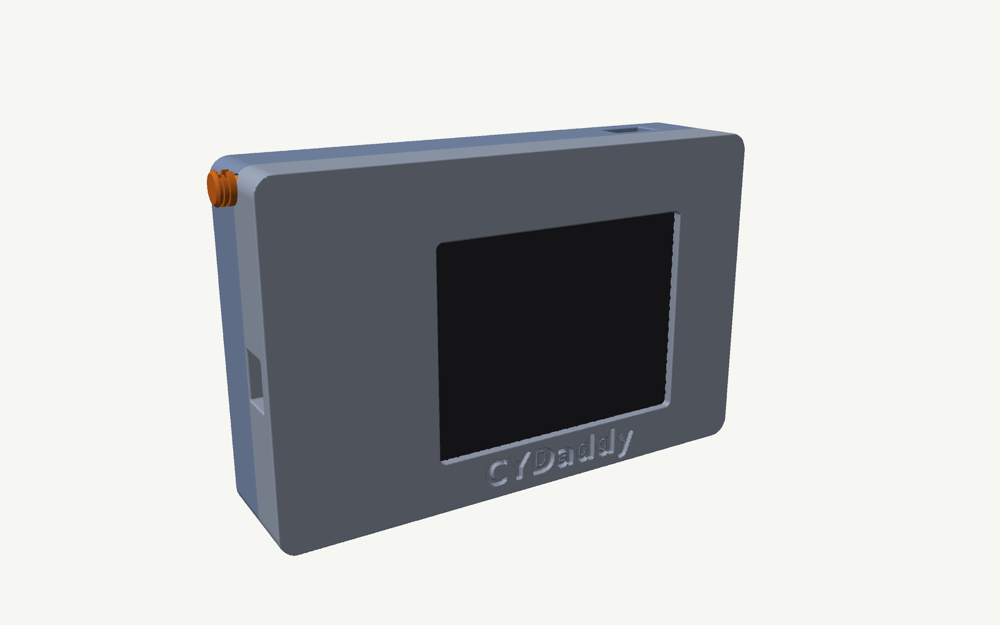

- **USB-C** (the CYD's own port) on the right end: charges and flashes.
- **BOOT / RST** through a 1.2 mm slot on the back, marked **B** and **R**.
- **Slide switch** on the top edge.
- **Stylus** in the top edge, knob at the lanyard end, plus a lanyard bar.
- **microSD:** there is no opening for it. The card is only reachable with the case open. (The game does not need it.)

Next: [05 Firmware](05_firmware.md)
